<p align="center">
  
</p>

Vertex is a general-purpose programming language. It is statically typed, reads
plainly, and compiles to native code with a single tool that needs nothing else
installed beside it.

[Compiler](https://github.com/vertex-language/vsc) ·
[Specification](https://github.com/vertex-language/vsc/blob/main/docs/vertex_spec.md) ·
[Editor support](https://github.com/vertex-language/vscode-vertex)

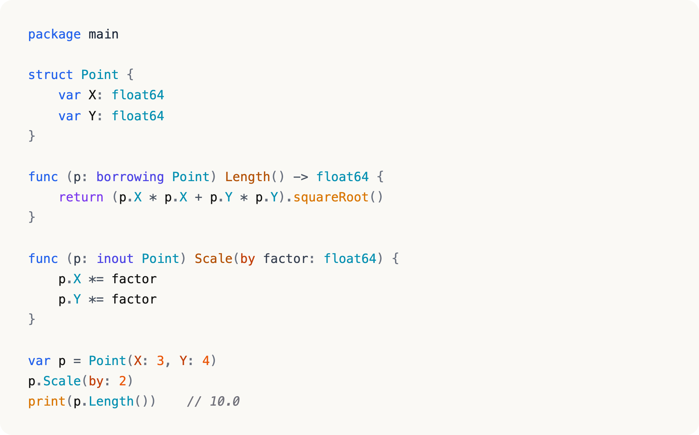

## Getting started

The compiler, `vsc`, is written in Go 1.25 and builds from a set of sibling
checkouts:

```
mkdir vertex && cd vertex
for repo in vsc vcx ir asm air amd64 arm64 i386 amdgpu ptx elf macho pe; do
    git clone https://github.com/vertex-language/$repo
done
cd vsc/cmd && go build -o ~/bin/vsc ./vsc
```

A program can be a single file:

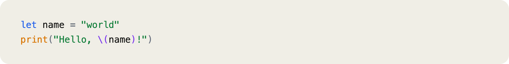

```
vsc run hello.vs
vsc build -o hello hello.vs
```

## The language

### Values

Types are written in lowercase, and collections are built in.

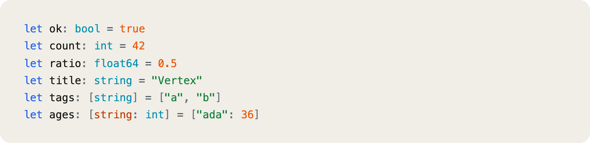

Structs are values, classes are references, and enums carry data and are matched
exhaustively.

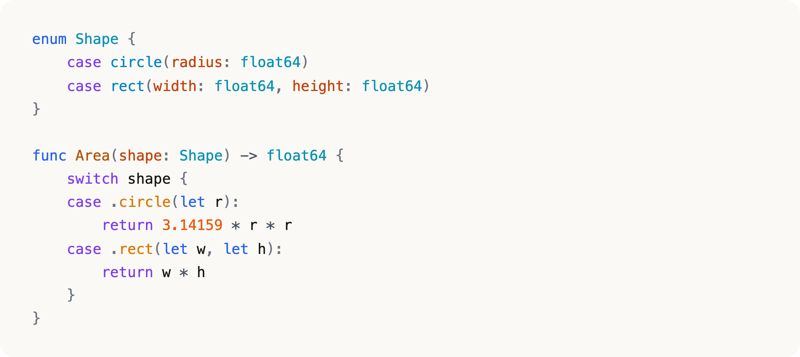

### Methods

A method can be written beside a type or apart from it. Written apart, it says
how it holds its receiver: `borrowing` to read, `inout` to change, `consuming`
to take.

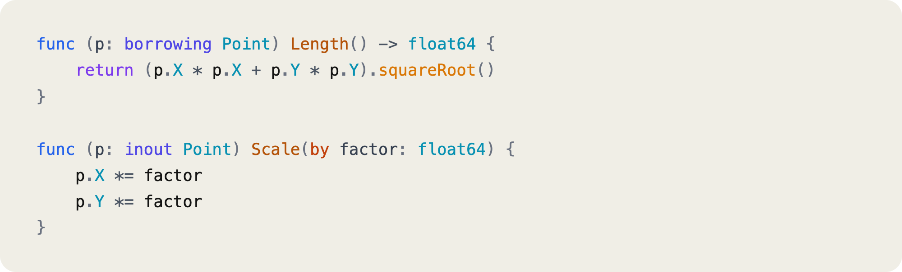

### Calls

A parameter is named once. A call may pass its arguments by name or in order.

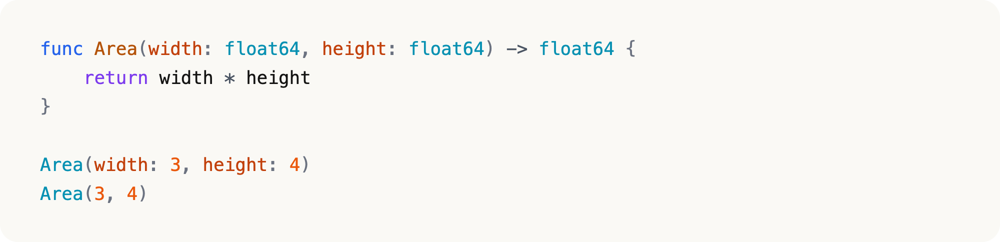

### Protocols and generics

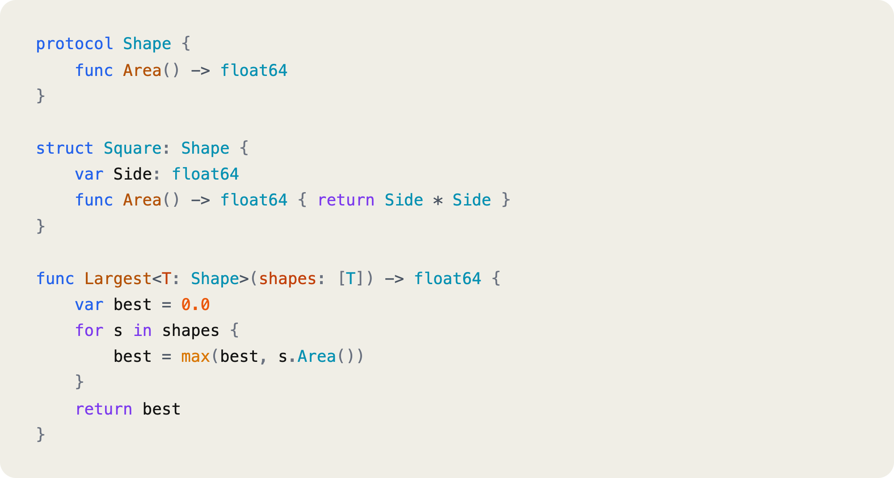

### Errors

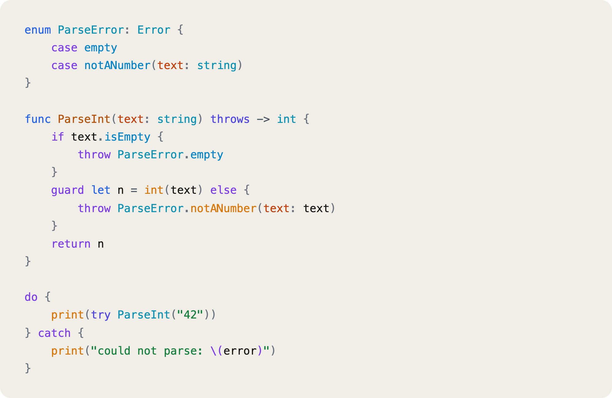

### Concurrency

Tasks run with `async` and `await`, side by side with `async let`, and actors
keep their state to themselves.

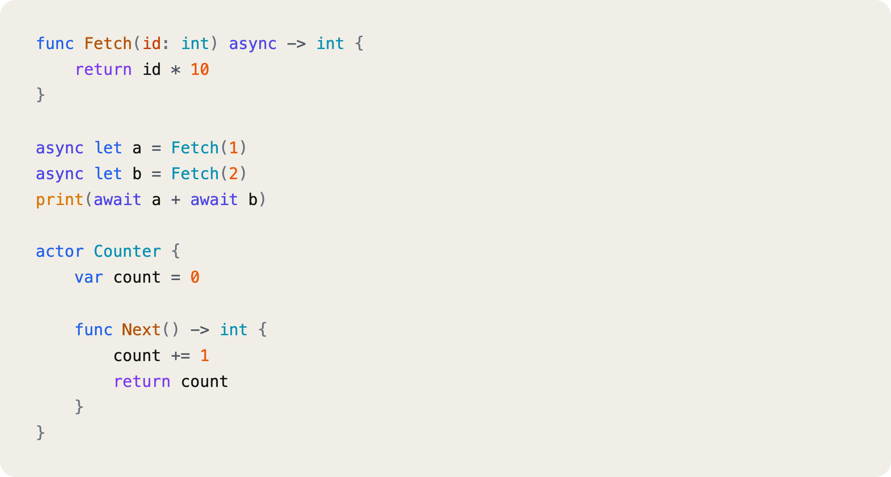

## Packages

A package is a folder, and a module is a folder with a `vs.mod`.

```
hello/
├── vs.mod
├── geometry/
│   └── geometry.vs
└── cmd/
    └── hello/
        └── main.vs
```

```
module example.com/hello

vertex 0.9
```

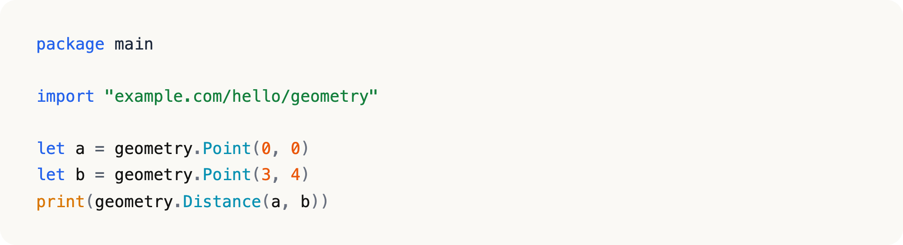

```
vsc run ./cmd/hello
```

The standard library is a set of packages, each in its own repository under
[vertex-language](https://github.com/vertex-language), imported by name:

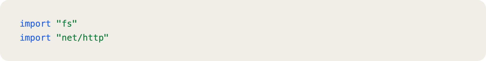

## Repositories

| | |
| :--- | :--- |
| [`vsc`](https://github.com/vertex-language/vsc) | The compiler |
| [`ir`](https://github.com/vertex-language/ir) | The intermediate representation and its lowerings |
| [`vcx`](https://github.com/vertex-language/vcx) | The C++ compiler for a package's native code |
| [`vscode-vertex`](https://github.com/vertex-language/vscode-vertex) | Editor support |

## License

[MIT](https://github.com/vertex-language/vsc/blob/main/LICENSE)
