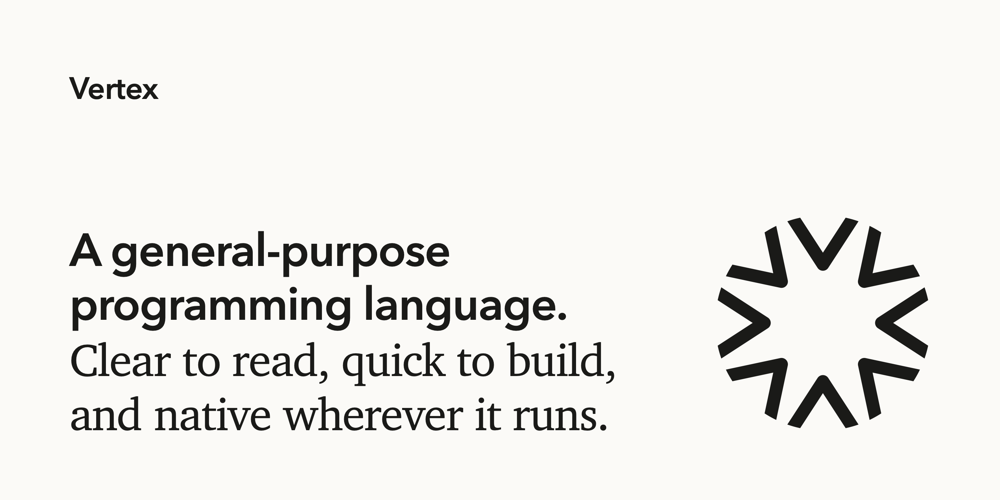

<p align="center">
  
</p>

Vertex is a general-purpose programming language. It is statically typed, reads
plainly, and compiles to native code with a single tool that needs nothing else
installed beside it.

[Compiler](https://github.com/vertex-language/vsc) ·
[Specification](https://github.com/vertex-language/vsc/blob/main/docs/vertex_spec.md) ·
[Editor support](https://github.com/vertex-language/vscode-vertex)

```
package main

struct Point {
    var X: float64
    var Y: float64
}

func (p: borrowing Point) Length() -> float64 {
    return (p.X * p.X + p.Y * p.Y).squareRoot()
}

func (p: inout Point) Scale(by factor: float64) {
    p.X *= factor
    p.Y *= factor
}

var p = Point(X: 3, Y: 4)
p.Scale(by: 2)
print(p.Length())    // 10.0
```

## Getting started

The compiler, `vsc`, is written in Go 1.25 and builds from a set of sibling
checkouts:

```
mkdir vertex && cd vertex
for repo in vsc vcx ir asm air amd64 arm64 i386 amdgpu ptx elf macho pe; do
    git clone https://github.com/vertex-language/$repo
done
cd vsc/cmd && go build -o ~/bin/vsc ./vsc
```

A program can be a single file:

```
let name = "world"
print("Hello, \(name)!")
```

```
vsc run hello.vs
vsc build -o hello hello.vs
```

## The language

### Values

Types are written in lowercase, and collections are built in.

```
let ok: bool = true
let count: int = 42
let ratio: float64 = 0.5
let title: string = "Vertex"
let tags: [string] = ["a", "b"]
let ages: [string: int] = ["ada": 36]
```

Structs are values, classes are references, and enums carry data and are matched
exhaustively.

```
enum Shape {
    case circle(radius: float64)
    case rect(width: float64, height: float64)
}

func Area(shape: Shape) -> float64 {
    switch shape {
    case .circle(let r):
        return 3.14159 * r * r
    case .rect(let w, let h):
        return w * h
    }
}
```

### Methods

A method can be written beside a type or apart from it. Written apart, it says
how it holds its receiver: `borrowing` to read, `inout` to change, `consuming`
to take.

```
func (p: borrowing Point) Length() -> float64 {
    return (p.X * p.X + p.Y * p.Y).squareRoot()
}

func (p: inout Point) Scale(by factor: float64) {
    p.X *= factor
    p.Y *= factor
}
```

### Calls

A parameter is named once. A call may pass its arguments by name or in order.

```
func Area(width: float64, height: float64) -> float64 {
    return width * height
}

Area(width: 3, height: 4)
Area(3, 4)
```

### Protocols and generics

```
protocol Shape {
    func Area() -> float64
}

struct Square: Shape {
    var Side: float64
    func Area() -> float64 { return Side * Side }
}

func Largest<T: Shape>(shapes: [T]) -> float64 {
    var best = 0.0
    for s in shapes {
        best = max(best, s.Area())
    }
    return best
}
```

### Errors

```
enum ParseError: Error {
    case empty
    case notANumber(text: string)
}

func ParseInt(text: string) throws -> int {
    if text.isEmpty {
        throw ParseError.empty
    }
    guard let n = int(text) else {
        throw ParseError.notANumber(text: text)
    }
    return n
}

do {
    print(try ParseInt("42"))
} catch {
    print("could not parse: \(error)")
}
```

### Concurrency

Tasks run with `async` and `await`, side by side with `async let`, and actors
keep their state to themselves.

```
func Fetch(id: int) async -> int {
    return id * 10
}

async let a = Fetch(1)
async let b = Fetch(2)
print(await a + await b)

actor Counter {
    var count = 0

    func Next() -> int {
        count += 1
        return count
    }
}
```

## Packages

A package is a folder, and a module is a folder with a `vs.mod`.

```
hello/
├── vs.mod
├── geometry/
│   └── geometry.vs
└── cmd/
    └── hello/
        └── main.vs
```

```
module example.com/hello

vertex 0.9
```

```
package main

import "example.com/hello/geometry"

let a = geometry.Point(0, 0)
let b = geometry.Point(3, 4)
print(geometry.Distance(a, b))
```

```
vsc run ./cmd/hello
```

The standard library is a set of packages, each in its own repository under
[vertex-language](https://github.com/vertex-language), imported by name:

```
import "fs"
import "net/http"
```

## Repositories

| | |
| :--- | :--- |
| [`vsc`](https://github.com/vertex-language/vsc) | The compiler |
| [`ir`](https://github.com/vertex-language/ir) | The intermediate representation and its lowerings |
| [`vcx`](https://github.com/vertex-language/vcx) | The C++ compiler for a package's native code |
| [`vscode-vertex`](https://github.com/vertex-language/vscode-vertex) | Editor support |

## License

[MIT](https://github.com/vertex-language/vsc/blob/main/LICENSE)
